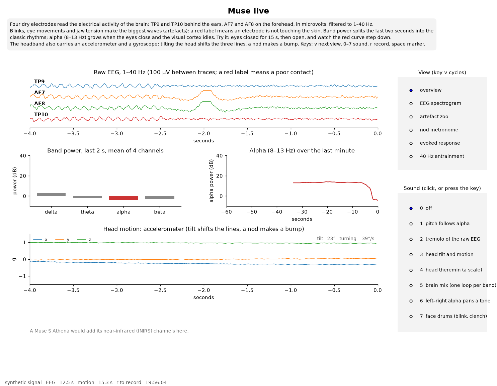

# Muse live

Live signals from a Muse headband in one window, for teaching: the four EEG channels, band powers, alpha over time, head motion from the accelerometer and gyroscope, the Athena's near-infrared channels, six views that each make one point about brain signals, eight sonifications, and recording to CSV. Made for the course MUS2640 Sensing Sound and Music at the University of Oslo.

It talks to the headband directly through [bleak](https://github.com/hbldh/bleak) and the Muse protocol implementations in [muselsl](https://github.com/alexandrebarachant/muse-lsl). No browser, no Web Bluetooth, no LSL stream to set up.



## Which headbands

One script serves all of them. After connecting it reads the device's characteristic table and picks the decoder.

- Muse 2016 (MU-02): verified. 256 EEG samples per second per channel, 52 from the accelerometer and gyroscope.
- Muse S Athena (2025): verified. The same, plus 64 samples per second from the near-infrared optodes, shown as a row in the overview.
- Muse 2 and Muse S (first and second generation): same protocol as the 2016 model in muselsl, so they should work; not tried.

## Run

```bash
python3 -m venv .venv
.venv/bin/pip install -r requirements.txt
.venv/bin/python muse_demo.py
```

The script scans for 12 s, connects to the first Muse it finds, and opens the window. To skip the scan give the address; to skip the probe give the model:

```bash
.venv/bin/python muse_demo.py --address AA:BB:CC:DD:EE:FF
.venv/bin/python muse_demo.py --address AA:BB:CC:DD:EE:FF --model athena
```

Other options:

```bash
.venv/bin/python muse_demo.py --view zoo          # start in a view: overview, spectrogram, zoo, nod, erp, assr
.venv/bin/python muse_demo.py --sound brainmix    # start with a sonification on
.venv/bin/python muse_demo.py --test 8            # capture 8 s, print sample counts and statistics, no window
.venv/bin/python muse_demo.py --fake              # synthetic signals, no headband (also --fake-athena)
.venv/bin/python muse_demo.py --fake --view erp --save erp.png   # render one frame of a view to a file
.venv/bin/python muse_demo.py --no-sound          # no audio stream at all
```

## The views

Switch with the buttons on the right or the key `v`.

| View | What it shows | The point |
|---|---|---|
| overview | Raw EEG, band powers, alpha over a minute, accelerometer; the Athena's fNIRS row | Eyes closed for 15 s and alpha rises; a red label is a poor contact |
| EEG spectrogram | A scrolling spectrogram of the best channel, 0 to 40 Hz, 20 s | The picture students have read for sound, now of a brain signal; alpha is a band at 10 Hz |
| artefact zoo | Prompts (blink, look left and right, clench, chew, speak, nod, eyes closed) over 8 s of raw EEG and the gyroscope, with detected blinks and clenches marked | Most of what an untrained eye calls brain activity is the face |
| nod metronome | Rotation speed with detected nods; a metronome (`m`) that follows the nod rate; a histogram of nod minus click | The negative mean asynchrony, measured on the student's own head |
| evoked response | Clicks about once a second, started with the view (`e` stops them); the EEG averaged around each click, channel by channel, with the kept and rejected counts shown | How event-related potentials are made, and why single trials show nothing; Bluetooth jitter smears the peaks |
| 40 Hz entrainment | A click train at 40 per second, started with the view (`a` stops it); the averaged EEG spectrum 20 to 60 Hz in 4 s windows, the 40 Hz peak against its neighbours, and a plot of that ratio as the average grows | The auditory steady-state response, an entrainment measured in the brain; about half a microvolt, so it needs headphones, minutes and a still head, and with four dry electrodes it may never clear the noise |

`c` resets the averages in the last two views. The 40 Hz view notches out the mains hum (50 Hz by default, `--mains 60` elsewhere) before averaging, since the body picks it up as an antenna and it would otherwise dominate the spectrum; the band is marked on the plot. Both views detrend each epoch or window and keep a channel only if its peak-to-peak stays under 200 µV (epochs) or 400 µV (windows); the counts on the plot say how many were kept per channel and how many were rejected. If everything is rejected, the problem is the contacts or the jaw, not the brain.

## The sounds

Switch with the buttons or the keys `0` to `7`. All of them render in one audio callback.

1. Pitch follows alpha: a sine from 220 Hz at the lowest alpha of the last minute to 880 Hz at the highest.
2. Tremolo of the raw EEG: a 200 Hz tone whose loudness follows the raw EEG of the best channel in real time; alpha is a 10 Hz tremolo, a blink a thump.
3. Head tilt and motion: pitch from how far the head is tilted from where it started, loudness from how fast it turns.
4. Head theremin: the same, with the pitch snapped to a pentatonic scale.
5. Brain mix: a four-layer loop at 120 BPM, bass from delta, pad from theta, arpeggio from alpha, hi-hats from beta, each at a volume set by its band's power against the last minute's range. Nothing is controlled, and that is the lesson.
6. Left–right alpha pans a tone: alpha on TP9 and AF7 against AF8 and TP10 sets the stereo position. It drifts with contact quality alone, which is the argument against reading emotion from frontal asymmetry.
7. Face drums: a blink triggers a kick, a jaw clench a snare. A brain–computer interface in the loosest sense, and a demonstration of why real ones are hard.

## Recording

`r` starts and stops a recording; `space` writes a marker (in the artefact zoo it carries the current prompt). Each recording is a folder under `recordings/` with `eeg.csv` (256 Hz), `acc.csv` and `gyro.csv` (52 Hz), `optics.csv` (64 Hz, Athena), `bands.csv` (one row per screen update) and `markers.csv`, all with seconds since the recording started in the first column.

## Before a demonstration

1. Charge the headband. Switch it on; the light blinks while it waits for a connection. The 2016 model switches itself off after a few minutes without one.
2. The Muse must not be paired in the computer's Bluetooth settings. A system pairing holds the connection and nothing else can reach the device, which is also why browser tools such as EEGEdu show nothing in that state. On Linux: `bluetoothctl remove <address>`.
3. Close the Muse app on any phone nearby; it grabs the headband as soon as it sees it.
4. Only one program can hold the headband. The first connection after it wakes can take 20 s.
5. Run `--test 8` once. Expect about 2048 EEG samples per channel and 416 from the accelerometer (and 512 optics samples on an Athena). Standard deviations above a few hundred microvolts mean a poor contact, or that the band is lying on the table.
6. Try the window on the synthetic signal first (`--fake`), so that the views and keys are familiar before a class.

## Notes

- Code: `muse_live/signals.py` (ring buffers, connection, the synthetic headband), `analysis.py` (filters, band powers, head pose, blink and clench and nod detectors, online averaging), `sound.py` (the audio engine), `record.py`, `views.py` (the window); `muse_demo.py` is the entry point.
- The pin `bitstring<5` in requirements.txt matters: muselsl's packet decoder uses a call that bitstring 5 removed, and without the pin the headband connects but no samples ever arrive.
- muselsl's own auto-detection subscribes to the old EEG characteristics before it probes, which fails on an Athena; this script probes with a bare connection first.
- Sound uses [sounddevice](https://python-sounddevice.readthedocs.io/), which needs the PortAudio library (`libportaudio2` on Debian and Ubuntu). Plotting uses matplotlib's Tk backend (`python3-tk`).
- Timing: click times are taken from the audio clock and EEG sample times from their arrival over Bluetooth, so the evoked-response and asynchrony views carry a jitter of some tens of milliseconds. Good enough to see the effects, not good enough to publish.

## Licence

MIT. Written by Alexander Refsum Jensenius with Claude.
